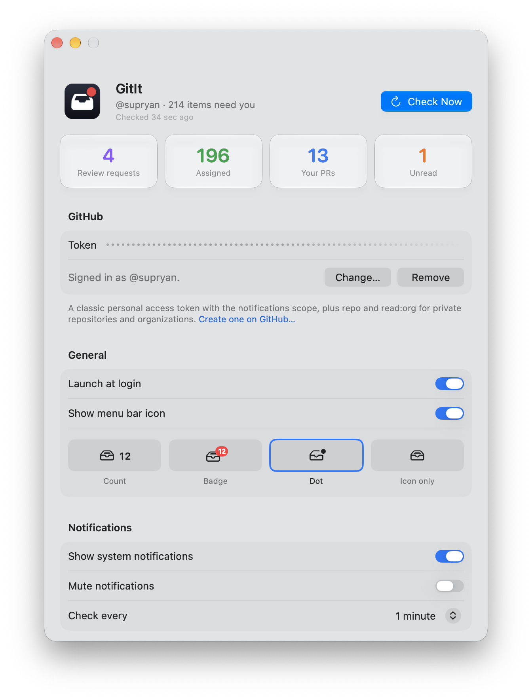
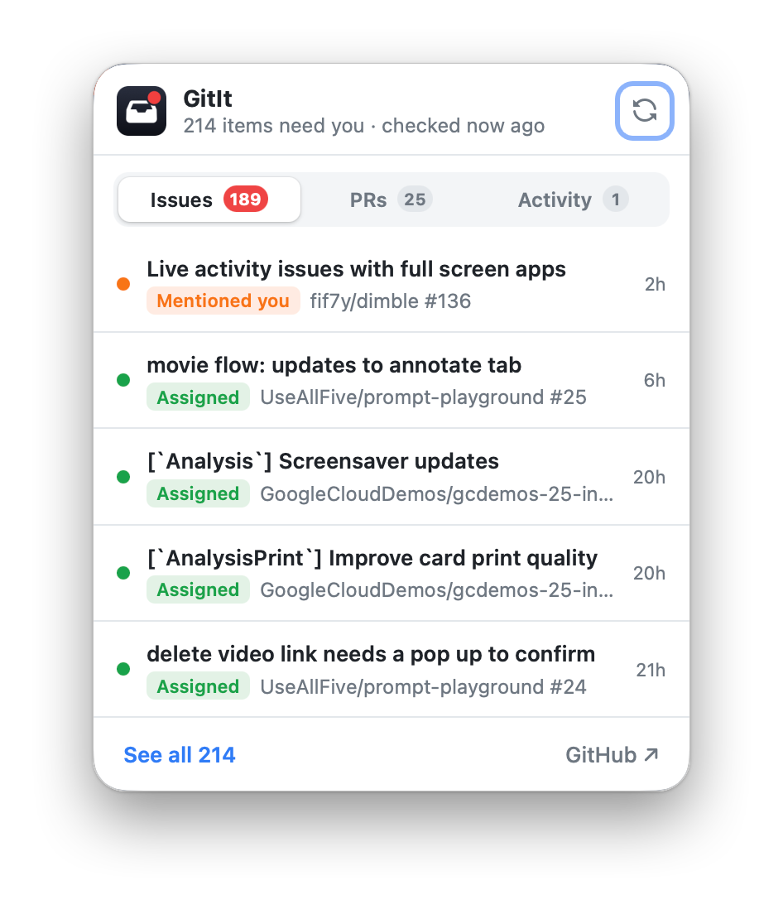

#  GitIt

Everything on GitHub that's waiting on you (your open PRs, review requests, assigned issues/PRs and unread notifications) in your menu bar, your notifications and your browser toolbar.

<p align="center">
  
  &nbsp;
  
</p>

## The Mac app

GitIt is a small macOS app that does the work: it checks GitHub in the background and feeds the browser extensions, so your token never leaves the app.

- 🔔 **Native notifications** for each new item; click one to open it on GitHub
- 📍 **Menu bar icon** in four styles (count, badge, dot or icon only), with a quick list grouped by why each item needs you
- 🔄 **Background checks** every 1–60 minutes, or on demand with Check Now
- 🧩 **Browser extensions** enabled and managed from one Settings window
- 🔒 **Private by design:** your token stays in the Keychain, and the extensions never touch the network

## Browser extensions

### Safari

- 🔢 **Toolbar badge** with the count of everything waiting on you
- 🗂️ **Popup** with Issues, PRs and Activity tabs, showing the most recent items
- 📋 **Dashboard** listing everything, grouped by why it needs you

### Chrome

The same badge, popup and dashboard, fed by the same Mac app. Install it from GitIt's settings: **Browser Extensions > Chrome > Install…**, then load it in Chrome as the app shows you. More in [`chrome/README.md`](chrome/README.md).

## Install

Requires macOS 14+ and Xcode 16+.

```sh
cp app/Config/Local.example.xcconfig app/Config/Local.xcconfig   # optional: add your Team ID
make install                                                            # builds, installs to ~/Applications, opens
```

Without a Team ID the app is signed ad-hoc and Safari needs **Develop > Allow Unsigned Extensions**. More in [`app/README.md`](app/README.md).

**Setup:**

1. Create a [classic token](https://github.com/settings/tokens/new?scopes=notifications,repo,read:org&description=GitIt) with `notifications`, `repo`, `read:org`.
2. Paste it into GitIt's settings and press Save.
3. Under **Browser Extensions**, press **Enable…** next to Safari and turn GitIt on, and **Install…** next to Chrome if you use it.
